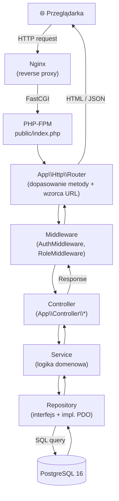

# ApexSteward (FIA Stewards Hub)

System zarządzania incydentami wyścigowymi i orzecznictwem sędziowskim FIA w Formule 1.

Platforma umożliwia szefom zespołów F1 (`TEAM_PRINCIPAL`) oficjalne zgłaszanie protestów z materiałem dowodowym (onboard / telemetria), sędziom FIA (`FIA_STEWARD`) pełne procedowanie spraw z katalogiem kar i atomowym naliczaniem punktów Superlicencji, a procesom autonomicznym (`CRON_SYSTEM`) cykliczne wygaszanie punktów karnych starszych niż 365 dni.

---

## Tech stack

| Warstwa | Technologie |
|---|---|
| **Backend** | PHP 8.3 (czyste programowanie obiektowe, MVC, PSR-4/12, PDO) |
| **Baza danych** | PostgreSQL 16 (transakcje ACID, widoki, 3NF) |
| **Frontend** | Semantyczny HTML5, nowoczesny CSS (zmienne, dark/light mode), Vanilla JS |
| **Serwer HTTP** | Nginx (reverse proxy, static files, upload protection) |
| **Poczta dev** | Mailpit (SMTP server + Web UI) |
| **Konteneryzacja** | Docker & Docker Compose |

---

## Usługi Docker i mapowanie portów

Projekt uruchamia 5 współpracujących usług w dedykowanych sieciach Docker:

| Usługa | Obraz / Dockerfile | Port zewnętrzny (Host) | Port wewnętrzny (Kontener) | Opis |
|---|---|---|---|---|
| **`server`** | `docker/nginx/Dockerfile` | `8080` (`APP_PORT`) | `80` | Serwer HTTP Nginx, punkt wejścia do aplikacji |
| **`php`** | `docker/php/Dockerfile` | - | `9000` | Interpreter PHP 8.3-FPM z rozszerzeniami PDO PgSQL |
| **`db`** | `docker/db/Dockerfile` (Postgres 16) | `5432` (`POSTGRES_PORT`) | `5432` | Baza danych PostgreSQL z wolumenem `pgdata` |
| **`mailpit`** | `axllent/mailpit:latest` | `8025` (`MAILPIT_PORT`)<br>`1025` (`SMTP_PORT`) | `8025`<br>`1025` | Web UI podglądu poczty oraz serwer SMTP |
| **`pgadmin-wdpai`** | `dpage/pgadmin4:latest` | `5050` (`PGADMIN_PORT`) | `80` | Graficzny interfejs administracji bazą PostgreSQL |

Komunikacja między kontenerami odbywa się **wyłącznie po nazwach usług** (`host=db`, `host=mailpit`, `host=php`).

---

## Zmienne środowiskowe (.env)

Konfiguracja aplikacji zarządzana jest przez zmienne środowiskowe. W repozytorium znajduje się bezpieczny szablon `.env.example`.

| Zmienna | Wartość domyślna | Opis |
|---|---|---|
| `APP_NAME` | `ApexSteward` | Nazwa aplikacji |
| `APP_ENV` | `local` | Środowisko uruchomieniowe (`local`, `production`) |
| `APP_PORT` | `8080` | Port HTTP serwera Nginx na hoście |
| `APP_URL` | `http://localhost:8080` | Pełny adres bazowy aplikacji |
| `DB_HOST` | `db` | Nazwa usługi bazy danych w Dockerze |
| `DB_PORT` | `5432` | Port bazy danych wewnątrz sieci Dockera |
| `DB_NAME` | `apex_steward` | Nazwa bazy danych |
| `DB_USER` | `docker` | Użytkownik bazy danych |
| `DB_PASSWORD` | `docker` | Hasło użytkownika bazy danych |
| `POSTGRES_PORT`| `5432` | Port PostgreSQL wystawiony na maszynę hosta |
| `SMTP_HOST` | `mailpit` | Nazwa usługi serwera SMTP dla PHPMailer |
| `SMTP_PORT` | `1025` | Port SMTP serwera Mailpit |
| `MAILPIT_PORT` | `8025` | Port Web UI skrzynki Mailpit na hoście |
| `PGADMIN_PORT` | `5050` | Port interfejsu PgAdmin na hoście |

---

## Architektura aplikacji (MVC)

Projekt wykorzystuje warstwową architekturę MVC bez zewnętrznego frameworka. Każda warstwa ma jasno zdefiniowaną odpowiedzialność i kierunek zależności.



### Warstwy i odpowiedzialności

| Warstwa | Namespace / Ścieżka | Odpowiedzialność |
|---|---|---|
| **Router** | `App\Http\Router` | Dopasowanie URL+metody, wyodrębnienie parametrów, uruchomienie łańcucha middleware |
| **Middleware** | `App\Middleware\*` | Uwierzytelnianie (`AuthMiddleware`), autoryzacja ról (`RoleMiddleware`), CSRF |
| **Controller** | `App\Controller\*` | Przyjmuje Request, waliduje dane wejściowe, deleguje do Service, zwraca Response |
| **Service** | `App\Service\*` | Cała logika biznesowa; brak SQL, brak HTML; operacje transakcyjne ACID |
| **Repository** | `App\Repository\*` | Jedyne miejsce z SQL; zaimplementowane przez interfejsy; wstrzykiwane przez DI |
| **Model** | `App\Model\*` | Niemutowalne encje domenowe (immutable value objects, metody `with*()`) |
| **View** | `public/views/` | Czysty HTML + PHP pętle/warunki; tylko `htmlspecialchars()` bez logiki |

---

## Routing

`App\Http\Router` dopasowuje metodę HTTP (GET/POST) oraz wzorzec ścieżki. Query string nie wchodzi do wzorca, odczytuje się go przez `Request::getQuery()`.

| Rodzaj trasy | Zapis | Zachowanie |
|---|---|---|
| Statyczna | `/login`, `/incidents` | dopasowanie dosłowne |
| Parametr ścieżki | `/incidents/{id}` | `{id}` musi być liczbą całkowitą > 0, w przeciwnym razie **400** |
| Regex | `/lang/(pl\|en)` | segment w nawiasach jest użyty jako wyrażenie regularne, brak dopasowania daje **404** |
| Query | `/incidents?status=REPORTED&gp=3` | `$request->getQuery('status')` |

Trasy z parametrem rejestruj po trasach statycznych o tym samym prefiksie (np. `/incidents/create` przed `/incidents/{id}`), bo router wybiera pierwszą pasującą.

### Obsługa błędów

Kontroler lub middleware może rzucić `App\Exception\HttpException` (`BadRequestException` 400, `UnauthorizedException` 401, `ForbiddenException` 403, `NotFoundException` 404, `UnprocessableEntityException` 422). Router zamienia go na odpowiedź:

- strony HTML: widok `error.html.php` w standardowym layoucie (`ErrorController`),
- ścieżki `/api/*`: JSON `{ "error": { "code": "not_found", "message": "…" } }`.

Nieobsłużony wyjątek daje **500** (szczegóły trafiają do `error_log`, nie do odpowiedzi).

### Zarejestrowane trasy

Trasy są zdefiniowane w `config/routes.php`.

| Metoda | Ścieżka | Kontroler::akcja |
|---|---|---|
| GET | `/` | `HomeController::index` |
| GET, POST | `/login` | `AuthController::login` |
| GET, POST | `/register` | `AuthController::register` |

Demo błędów: nieistniejąca ścieżka (`/nope`) zwraca 404 ze stroną błędu, bez wyjątku PHP. Walidację `{id}` (400 dla `abc`, `0`, `-1`) router stosuje do każdej trasy z parametrem, np. przyszłej `/incidents/{id}`.

### Wstrzykiwanie zależności (DI)

`public/index.php` tylko ładuje autoloader, buduje kontener (`config/container.php`), pobiera z niego `Router` i rejestruje trasy z `config/routes.php`. `Router` tworzy kontrolery i middleware przez `Container::get()`, który automatycznie wstrzykuje zależności z typów w konstruktorach (autowiring). W kontenerze rejestruje się tylko to, czego nie da się wywnioskować z typów, np. powiązanie interfejsu repozytorium z implementacją PDO.

---

## Layout i design system

Wszystkie widoki są renderowane wewnątrz `public/views/layout.html.php` (przez `AbstractController::render()`), który składa stronę z partiali, więc nagłówek i stopka istnieją w jednym miejscu:

| Partial (`public/views/partials/`) | Zawartość |
|---|---|
| `header.html.php` | znak „F1 STEWARDS”, górna nawigacja, chip użytkownika, wylogowanie, przełącznik motywu |
| `tabbar.html.php` | dolny pasek zakładek na telefonie (te same linki co nagłówek) |
| `flash.html.php` | komunikaty (`role="alert"` dla błędów, `role="status"` dla reszty) |
| `footer.html.php` | stopka „ApexSteward · FIA Stewards Hub” |
| `form-field.html.php` | pole formularza z `<label for>`, podpowiedzią i błędem (`aria-describedby`, `aria-invalid`) |

Nawigację i dane użytkownika widok dostaje jako zmienne `$navItems` i `$currentUser` (ustawi je warstwa uwierzytelniania); dla gościa pasek nawigacji się nie wyświetla.

Styl (`public/css/style.css`, bez stylów inline) opiera się na zmiennych CSS: kolory, statusy spraw (`--st-*`), typografia, promień i odstępy. Motyw jasny jest w `:root`, ciemny w `[data-theme="dark"]`; blokujący skrypt w `<head>` ustawia `data-theme` przed pierwszym renderem (brak FOUC). Komponenty: `.button`, `.card`, `.badge--*`, `.table`, `.form-field`, `.alert`. Układ jest responsywny: pasek górny od 768 px, dolny pasek zakładek poniżej.

---

## Szybki start (Czyste środowisko)

```bash
# 1. Sklonuj repozytorium
git clone https://github.com/Dysky2/wdpai-project.git
cd wdpai-project

# 2. Utwórz plik konfiguracji lokalnej
cp .env.example .env

# 3. Uruchom kontenery przez Docker Compose
docker compose up --build -d
```

Autoloader Composera (`vendor/`) generuje się automatycznie: obraz PHP wykonuje `composer install` przy buildzie, a entrypoint (`docker/php/docker-entrypoint.sh`) powtarza to przy starcie kontenera, gdy brakuje `vendor/autoload.php` lub zmienił się `composer.lock` (bind mount `.:/app` przykrywa katalog z obrazu). Ręczna instalacja nie jest potrzebna.

### Dostęp do usług:
- **Aplikacja webowa:** [http://localhost:8080](http://localhost:8080)
- **Skrzynka pocztowa (Mailpit):** [http://localhost:8025](http://localhost:8025)
- **PgAdmin:** [http://localhost:5050](http://localhost:5050) (login: `admin@wdpai.pl`, hasło: `admin`)

---

## Zasady developmentu

- Branch dla każdego zadania (konwencja `WDP-XX`).
- Małe, logiczne commity zgodne z konwencją (`feat:`, `fix:`, `docs:`, `test:`, `refactor:`, `chore:`).
- Sekrety wyłącznie w `.env` (plik `.env` bezwzględnie w `.gitignore`).
