# ApexSteward (FIA Stewards Hub)

System zarządzania incydentami wyścigowymi i orzecznictwem sędziowskim FIA w Formule 1.

Platforma umożliwia szefom zespołów F1 (`TEAM_PRINCIPAL`) oficjalne zgłaszanie protestów z materiałem dowodowym (onboard / telemetria), sędziom FIA (`FIA_STEWARD`) pełne procedowanie spraw z katalogiem kar i atomowym naliczaniem punktów Superlicencji, a procesom autonomicznym (`CRON_SYSTEM`) cykliczne wygaszanie punktów karnych starszych niż 365 dni.

---

## Autorzy i zakres odpowiedzialności

| Autor | Zakres |
|---|---|
| Dawid (GitHub: [Dysky2](https://github.com/Dysky2)) | projekt i całość implementacji: infrastruktura Docker, baza danych, backend PHP (MVC), frontend, testy, dokumentacja |

Projekt zaliczeniowy z przedmiotu WDPAI. Historia zadań: tablica Trello WDPAI, jedna gałąź `WDP-NN` na kartę.

---

## Zrzuty ekranu

Zrzuty pochodzą z działającej aplikacji z danymi z `db/seed.sql` (desktop 1440 px, mobile 375 px), katalog `docs/screenshots/`.

| Widok | Desktop | Mobile |
|---|---|---|
| Logowanie | 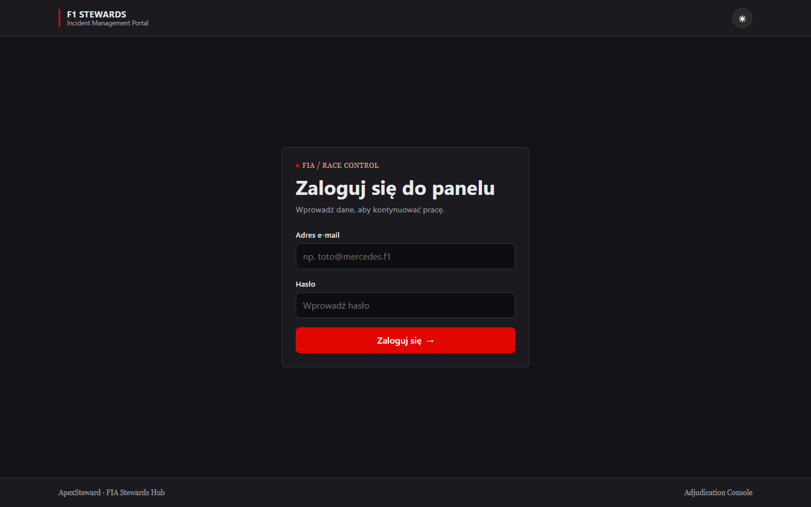 | 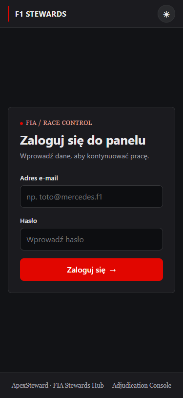 |
| Dziennik incydentów | 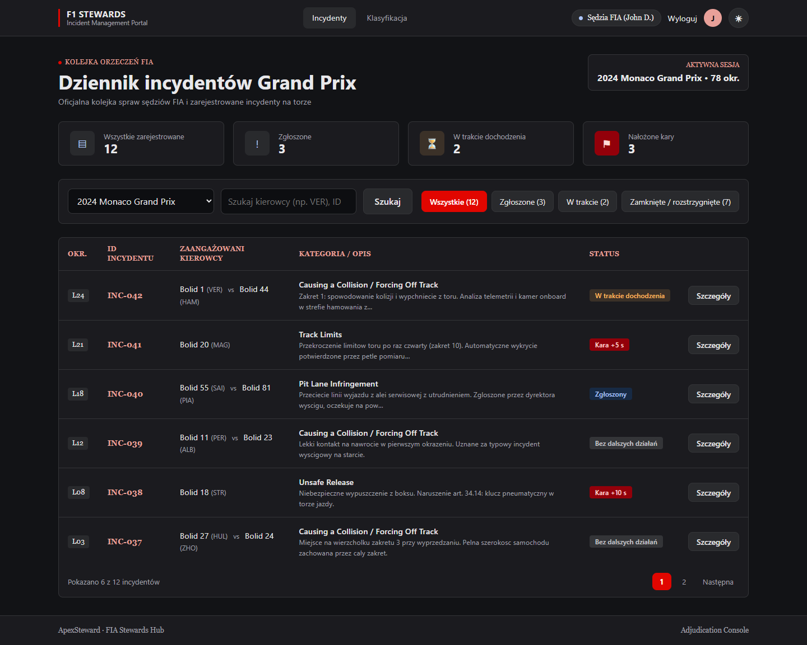 | 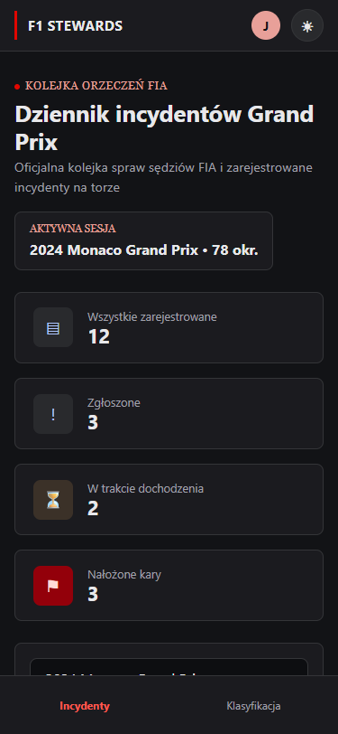 |
| Akta sprawy | 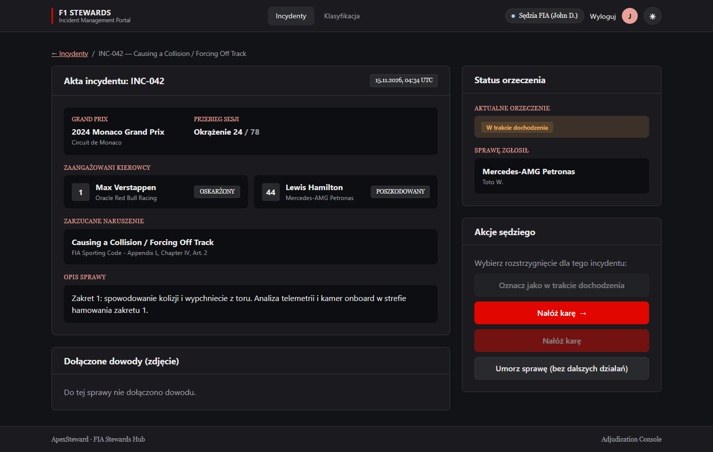 | 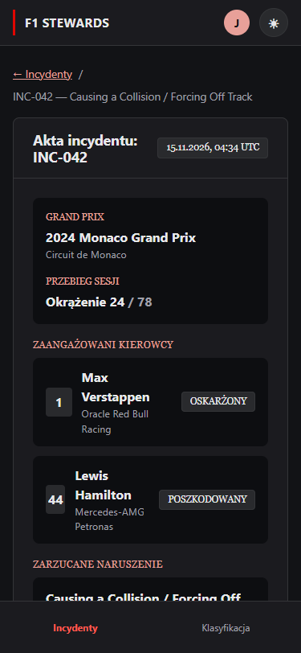 |
| Zgłoszenie protestu | 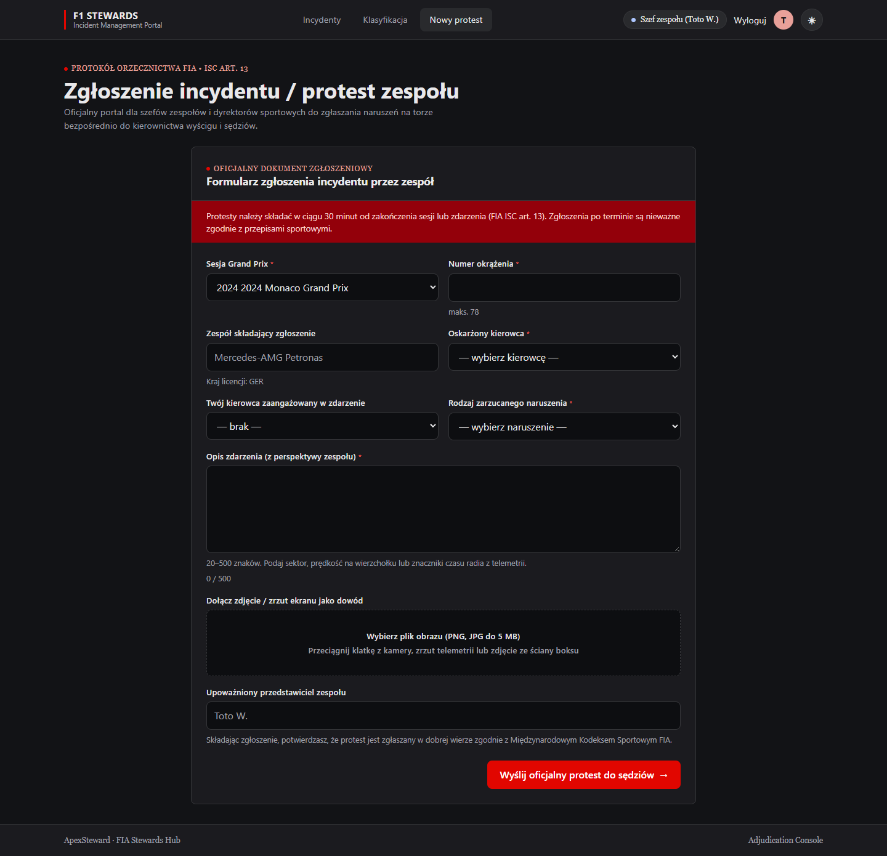 | 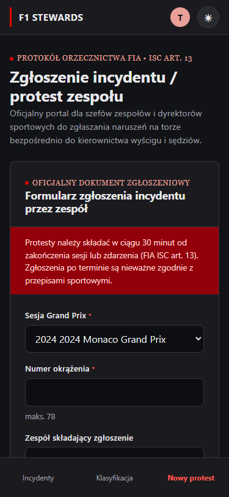 |
| Orzeczenie sędziego | 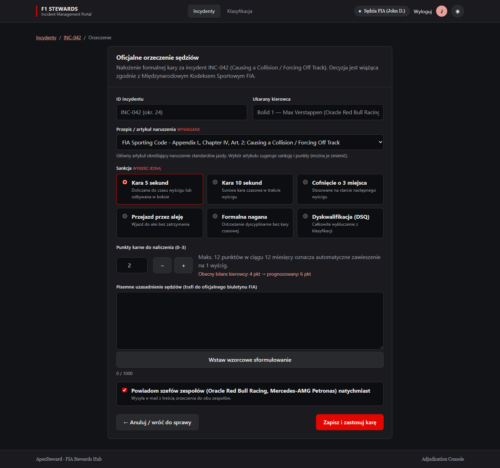 | 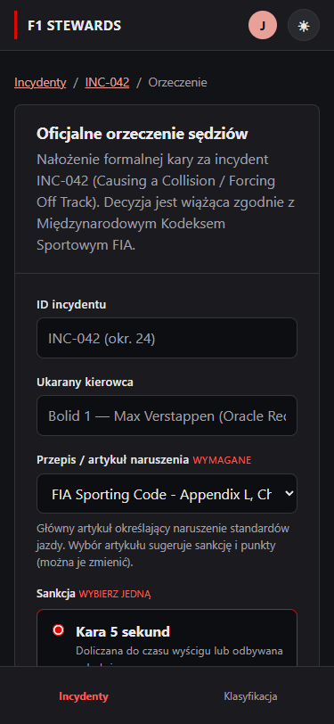 |
| Klasyfikacja Superlicencji | 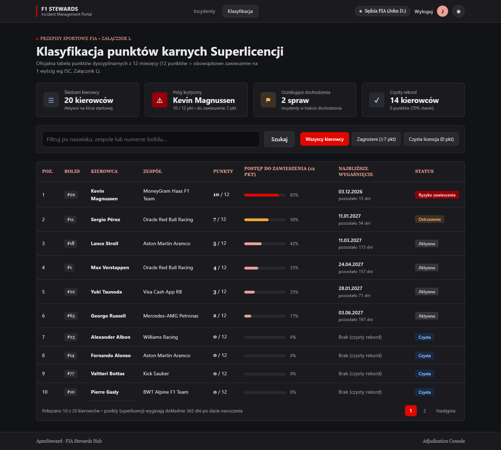 | 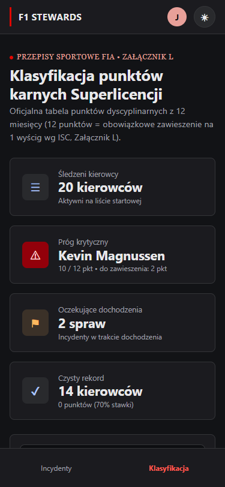 |

---

## Tech stack

| Warstwa | Technologie |
|---|---|
| **Backend** | PHP 8.3 (czyste programowanie obiektowe, MVC, PSR-4/12, PDO) |
| **Baza danych** | PostgreSQL 16 (transakcje ACID, widoki, 3NF) |
| **Frontend** | Semantyczny HTML5, nowoczesny CSS (zmienne, dark/light mode), Vanilla JS |
| **Serwer HTTP** | Nginx (reverse proxy, static files, upload protection) |
| **Poczta dev** | Mailpit (SMTP server + Web UI) |
| **Konteneryzacja** | Docker & Docker Compose |

---

## Usługi Docker i mapowanie portów

Projekt uruchamia 5 współpracujących usług w dedykowanych sieciach Docker:

| Usługa | Obraz / Dockerfile | Port zewnętrzny (Host) | Port wewnętrzny (Kontener) | Opis |
|---|---|---|---|---|
| **`server`** | `docker/nginx/Dockerfile` | `8080` (`APP_PORT`) | `80` | Serwer HTTP Nginx, punkt wejścia do aplikacji |
| **`php`** | `docker/php/Dockerfile` | - | `9000` | Interpreter PHP 8.3-FPM z rozszerzeniami PDO PgSQL |
| **`db`** | `docker/db/Dockerfile` (Postgres 16) | `5432` (`POSTGRES_PORT`) | `5432` | Baza danych PostgreSQL z wolumenem `pgdata` |
| **`mailpit`** | `axllent/mailpit:latest` | `8025` (`MAILPIT_PORT`)<br>`1025` (`SMTP_PORT`) | `8025`<br>`1025` | Web UI podglądu poczty oraz serwer SMTP |
| **`pgadmin-wdpai`** | `dpage/pgadmin4:latest` | `5050` (`PGADMIN_PORT`) | `80` | Graficzny interfejs administracji bazą PostgreSQL |

Komunikacja między kontenerami odbywa się **wyłącznie po nazwach usług** (`host=db`, `host=mailpit`, `host=php`).

---

## Zmienne środowiskowe (.env)

Konfiguracja aplikacji zarządzana jest przez zmienne środowiskowe. W repozytorium znajduje się bezpieczny szablon `.env.example`.

| Zmienna | Wartość domyślna | Opis |
|---|---|---|
| `APP_NAME` | `ApexSteward` | Nazwa aplikacji |
| `APP_ENV` | `local` | Środowisko uruchomieniowe (`local`, `production`) |
| `APP_PORT` | `8080` | Port HTTP serwera Nginx na hoście |
| `APP_URL` | `http://localhost:8080` | Pełny adres bazowy aplikacji |
| `DB_HOST` | `db` | Nazwa usługi bazy danych w Dockerze |
| `DB_PORT` | `5432` | Port bazy danych wewnątrz sieci Dockera |
| `DB_NAME` | `apex_steward` | Nazwa bazy danych |
| `DB_USER` | `apex_user` (wzorzec) | Użytkownik bazy danych |
| `DB_PASSWORD` | `change_me` (wzorzec) | Hasło użytkownika bazy danych; wymagane, ustaw własne w `.env` |
| `POSTGRES_PORT`| `5432` | Port PostgreSQL wystawiony na maszynę hosta |
| `SMTP_HOST` | `mailpit` | Nazwa usługi serwera SMTP dla PHPMailer |
| `SMTP_PORT` | `1025` | Port SMTP serwera Mailpit |
| `SMTP_USER`, `SMTP_PASS` | puste | Dane logowania SMTP (Mailpit działa bez uwierzytelniania) |
| `SMTP_ENCRYPTION` | puste | `tls` (STARTTLS), `ssl` (SMTPS) lub puste |
| `SMTP_FROM` | `stewards@apexsteward.local` | Adres nadawcy orzeczeń |
| `MAILPIT_PORT` | `8025` | Port Web UI skrzynki Mailpit na hoście |
| `PGADMIN_PORT` | `5050` | Port interfejsu PgAdmin na hoście |

**Poczta:** po orzeczeniu z zaznaczonym `notify_team` `PhpMailerMailer` (PHPMailer, SMTP) wysyła „FIA Stewards Decision” (HTML + AltBody z `public/views/emails/`) do szefów zespołu ukaranego kierowcy i zespołu zgłaszającego. Wysyłka następuje po commicie transakcji; błąd SMTP trafia do `storage/logs/app.log` i nie cofa kary. Temat i treść e-maila są zawsze po angielsku, niezależnie od języka interfejsu: to oficjalne orzeczenie FIA, a język odbiorcy (szefów zespołów) nie jest przechowywany w bazie. Podgląd: <http://localhost:8025>.

---

## Architektura aplikacji (MVC)

Projekt wykorzystuje warstwową architekturę MVC bez zewnętrznego frameworka. Każda warstwa ma jasno zdefiniowaną odpowiedzialność i kierunek zależności.

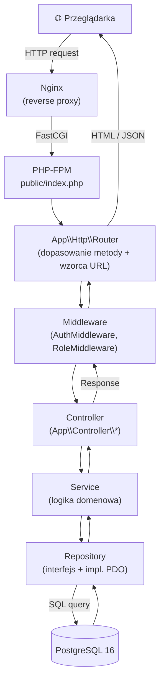

### Warstwy i odpowiedzialności

| Warstwa | Namespace / Ścieżka | Odpowiedzialność |
|---|---|---|
| **Router** | `App\Http\Router` | Dopasowanie URL+metody, wyodrębnienie parametrów, uruchomienie łańcucha middleware |
| **Middleware** | `App\Middleware\*` | Uwierzytelnianie (`AuthMiddleware`), autoryzacja ról (`RoleMiddleware`), CSRF |
| **Controller** | `App\Controller\*` | Przyjmuje Request, waliduje dane wejściowe, deleguje do Service, zwraca Response |
| **Service** | `App\Service\*` | Cała logika biznesowa; brak SQL, brak HTML; operacje transakcyjne ACID |
| **Repository** | `App\Repository\*` | Jedyne miejsce z SQL; zaimplementowane przez interfejsy; wstrzykiwane przez DI |
| **Model** | `App\Model\*` | Niemutowalne encje domenowe (immutable value objects, metody `with*()`) |
| **View** | `public/views/` | Czysty HTML + PHP pętle/warunki; tylko `htmlspecialchars()` bez logiki |

---

## Routing

`App\Http\Router` dopasowuje metodę HTTP (GET/POST) oraz wzorzec ścieżki. Query string nie wchodzi do wzorca, odczytuje się go przez `Request::getQuery()`.

| Rodzaj trasy | Zapis | Zachowanie |
|---|---|---|
| Statyczna | `/login`, `/incidents` | dopasowanie dosłowne |
| Parametr ścieżki | `/incidents/{id}` | `{id}` musi być liczbą całkowitą > 0, w przeciwnym razie **400** |
| Regex | `/lang/(pl\|en)` | segment w nawiasach jest użyty jako wyrażenie regularne, brak dopasowania daje **404** |
| Query | `/incidents?status=reported&gp=3` | `$request->getQuery('status')`; parametry dziennika waliduje `IncidentListQuery` (`status`: `all\|reported\|investigation\|closed`), nieznana wartość daje **422** |

Trasy z parametrem rejestruj po trasach statycznych o tym samym prefiksie (np. `/incidents/create` przed `/incidents/{id}`), bo router wybiera pierwszą pasującą.

### Obsługa błędów

Kontroler lub middleware może rzucić `App\Exception\HttpException` (`BadRequestException` 400, `UnauthorizedException` 401, `ForbiddenException` 403, `NotFoundException` 404, `UnprocessableEntityException` 422). Router zamienia go na odpowiedź:

- strony HTML: widok `error.html.php` w standardowym layoucie (`ErrorController`),
- ścieżki `/api/*`: JSON `{ "error": { "code": "not_found", "message": "…" } }`.

Nieobsłużony wyjątek daje **500** (szczegóły trafiają do `error_log`, nie do odpowiedzi).

### Zarejestrowane trasy

Trasy są zdefiniowane w `config/routes.php`.

| Metoda | Ścieżka | Kontroler::akcja |
|---|---|---|
| GET | `/` | `HomeController::index` |
| GET | `/lang/(pl\|en)` | `LanguageController::switch` (zapis języka w sesji, powrót na stronę z `Referer` tylko z tego samego hosta) |
| GET, POST | `/login` | `AuthController::login` |
| POST | `/logout` | `AuthController::logout` |
| GET | `/incidents` | `IncidentController::index` (query: `status` = `all\|reported\|investigation\|closed`, `gp` = `all` lub id, `q`, `page`; walidacja wspólna z `/api/incidents` (`IncidentListQuery`): błędne `status`, `gp` lub `page` → strona błędu 422) |
| GET | `/incidents/create`, POST `/incidents` | `IncidentController::create` (protest można złożyć tylko dla aktywnego Grand Prix: lista wyboru zawiera wyłącznie je, a serwer odrzuca każde inne `grand_prix_id` błędem 422 `validation.grand_prix_unknown`) |
| GET | `/incidents/{id}` | `IncidentController::show` (akta sprawy z bazy: JOIN GP, kierowców, zespołów, artykułu, dowodu i kary; `IncidentService::getForUser`: brak sprawy → 404, cudza sprawa → 403; panel „Akcje sędziego” tylko dla `FIA_STEWARD`) |
| GET, POST | `/stewards/adjudicate/{id}` | `StewardController::adjudicate` (formularz orzekania z presetami artykułów z bazy i prognozą punktów; sprawa musi być `UNDER_INVESTIGATION`, inaczej 422; zapis kary w S3-17) |
| GET | `/standings` | `StandingsController::index` (query: `filter`, `q`, `page`) |
| GET | `/api/incidents` | `ApiIncidentController::index` (JSON `{data: [IncidentRow], meta: {page, perPage, total}}`, te same query, walidacja i zakres co `/incidents`; błędne `status`, `gp` lub `page` → 422 w kontrakcie błędów, `perPage` jest stałe po stronie serwera, a `page` większe niż ostatnia strona jest przycinane do ostatniej) |
| POST | `/api/incidents/{id}/investigate` | `ApiIncidentController::investigate` (tylko `FIA_STEWARD`, nagłówek `X-CSRF-Token`; `REPORTED` → `UNDER_INVESTIGATION`) |
| POST | `/api/incidents/{id}/dismiss` | `ApiIncidentController::dismiss` (tylko `FIA_STEWARD`; `UNDER_INVESTIGATION` → `NO_FURTHER_ACTION`) |

Demo błędów: `/incidents/abc` i `/incidents/0` zwracają 400, `/incidents/999` oraz nieistniejąca ścieżka (`/nope`) zwracają 404, wszystko ze stroną błędu i bez wyjątku PHP. Cudza sprawa (`TEAM_PRINCIPAL` otwiera sprawę innego zespołu, także jej plik dowodu) zwraca **404**, identyczny jak dla nieistniejącego ID, żeby nie dało się sprawdzać, które ID istnieją (QA-06).

**Wylogowanie (test ręczny):** zaloguj się, kliknij „Wyloguj” (`POST /logout` z tokenem CSRF, bez tokenu 403 z komunikatem o tokenie CSRF). Sesja jest niszczona po stronie serwera, a ciasteczko wygaszane, więc przycisk Wstecz i ponowne wejście na `/incidents` przekierowują na `/login` (dla `/api/*` byłoby 401). Strony chronione wysyłają `Cache-Control: no-store, private`, więc przeglądarka nie pokazuje ich z cache.

> [!NOTE]
> **Stan:** logowanie, sesja i CSRF działają na prawdziwych kontach z seeda (brak rejestracji; konta tworzy seed). Dziennik incydentów (`/incidents`) czyta już z bazy: szef zespołu widzi sprawy swojego zespołu (zgłaszającego lub oskarżonego), sędzia wszystkie; filtry `status`, `gp` (domyślnie aktywne Grand Prix, `gp=all` = wszystkie), `q` (kod INC-NNN, kierowca, artykuł, opis) i `page` (6 na stronę). Akta sprawy, formularz orzeczenia i API czytają z bazy. Nowy protest (`/incidents/create`, tylko szef zespołu) zapisuje sprawę ze statusem `REPORTED` i opcjonalny dowód w jednej transakcji, po czym przekierowuje na `/incidents/{id}` z komunikatem; błędne dane dają 422 z komunikatem przy polu (m.in. oskarżony kierowca z własnego zespołu, okrążenie poza zakresem, opis poza 20–500 znaków, plik inny niż prawdziwy JPG/PNG do 5 MB). Orzeczenie (`/stewards/adjudicate/{id}`) zapisuje karę, status sprawy i punkty w jednej transakcji (przy 12 aktywnych punktach kierowca jest zawieszany). Klasyfikacja Superlicencji (`/standings`) czyta z widoku `v_super_licence_standings`: filtry `filter=all|risk|clean`, `q` i `page` (10 na stronę), status licencji z punktów (`LicenceStatus`).

### Wstrzykiwanie zależności (DI)

`public/index.php` tylko ładuje autoloader, buduje kontener (`config/container.php`), pobiera z niego `Router` i rejestruje trasy z `config/routes.php`. `Router` tworzy kontrolery i middleware przez `Container::get()`, który automatycznie wstrzykuje zależności z typów w konstruktorach (autowiring). W kontenerze rejestruje się tylko to, czego nie da się wywnioskować z typów, np. powiązanie interfejsu repozytorium z implementacją PDO.

---

## Layout i design system

Wszystkie widoki są renderowane wewnątrz `public/views/layout.html.php` (przez `AbstractController::render()`), który składa stronę z partiali, więc nagłówek i stopka istnieją w jednym miejscu:

| Partial (`public/views/partials/`) | Zawartość |
|---|---|
| `header.html.php` | znak „F1 STEWARDS”, górna nawigacja, chip użytkownika, wylogowanie, przełącznik motywu |
| `tabbar.html.php` | dolny pasek zakładek na telefonie (te same linki co nagłówek) |
| `flash.html.php` | komunikaty (`role="alert"` dla błędów, `role="status"` dla reszty) |
| `footer.html.php` | stopka „ApexSteward · FIA Stewards Hub” |
| `form-field.html.php` | pole formularza z `<label for>`, podpowiedzią i błędem (`aria-describedby`, `aria-invalid`) |

Nawigację i dane użytkownika widok dostaje jako zmienne `$navItems` i `$currentUser` (ustawi je warstwa uwierzytelniania); dla gościa pasek nawigacji się nie wyświetla.

Styl (`public/css/style.css`, bez stylów inline) opiera się na zmiennych CSS: kolory, statusy spraw (`--st-*`), typografia, promień i odstępy. Motyw jasny jest w `:root`, ciemny w `[data-theme="dark"]`; blokujący skrypt w `<head>` ustawia `data-theme` przed pierwszym renderem (brak FOUC). Komponenty: `.button`, `.card`, `.badge--*`, `.table`, `.form-field`, `.alert`. Układ jest responsywny: pasek górny od 768 px, dolny pasek zakładek poniżej.

### Wielojęzyczność (PL/EN, K30)

Domyślny język to polski; przełącznik PL/EN w nagłówku wywołuje `GET /lang/pl` lub `/lang/en`, a wybór trafia do sesji.

- Słowniki: `config/lang/pl.php` i `config/lang/en.php` (płaskie klucze kropkowe, np. `nav.incidents`, `status.REPORTED`, `validation.lap_range`). Oba pliki muszą mieć identyczny zestaw kluczy, pilnuje tego `TranslationKeysTest`.
- Widoki: `$view->t('klucz', ['max' => 5])` i `$view->te(...)` (z escapowaniem). Brakujący klucz wraca do polskiego, a w ostateczności jest wyświetlany jako sam klucz.
- Serwer tłumaczy też komunikaty walidacji (422), etykiety statusów i kar, komunikaty flash oraz błędy API (`error.message`).
- Skrypty: klucze `js.*` są osadzone w stronie jako JSON (`#i18n-data`) i czytane przez `public/js/i18n.js` (`t('js.modal.confirm')`).

### Dostępność (WCAG 2.1 AA)

Audyt ręczny kodu (2026-11-18): klawiatura (link „Przejdź do treści” z celem `#main[tabindex=-1]`, natywny `<dialog>` z Escape i powrotem fokusu), widoczny fokus (`:focus-visible`, ring na polach formularzy i polu uploadu), każde pole z `<label for>`, `aria-invalid`/`aria-describedby` dla błędów, `alt` dowodu i `aria-label` na logo, tabele z `<caption>` i `scope`, regiony `role="status"` dla wyników filtrowania, `prefers-reduced-motion`. Przełącznik motywu ma stałą etykietę i stan w `aria-pressed`.

Kontrast (obliczony wg WCAG, min. 4.5:1): tekst 16.8:1 (jasny) / 15.2:1 (ciemny), tekst pomocniczy 5.7–6.7:1 / 5.5–6.6:1, przycisk główny 4.97:1, odznaki statusów 6.3–8.4:1 (jasny) / 7.2–8.5:1 (ciemny), tekst akcentowy 4.6:1 / 5.6:1.

**Raport Lighthouse (kategoria Accessibility), 2026-11-26.** Lighthouse 12.6.1 uruchomiony przez Edge (headless) na lokalnej aplikacji; strony chronione z ciasteczkiem sesji stewarda lub szefa zespołu. Pełne raporty HTML (z listą zaliczonych audytów) leżą w [`docs/wcag/`](docs/wcag/).

| Ekran | Urządzenie | Wynik | Niezaliczone audyty |
|---|---|---|---|
| `/login` | desktop | 100 | 0 |
| `/login` | mobile (375 px) | 100 | 0 |
| `/incidents` (steward) | desktop | 100 | 0 |
| `/incidents` (steward) | mobile | 100 | 0 |
| `/incidents/{id}` (steward) | mobile | 100 | 0 |
| `/incidents/create` (szef zespołu) | desktop | 100 | 0 |
| `/standings` (steward) | desktop | 100 | 0 |
| `/stewards/adjudicate/{id}` (steward) | desktop | 100 | 0 |

**Naprawione uwagi:** pierwszy przebieg wykazał w nagłówku audyt `label-content-name-mismatch` (WCAG 2.5.3): `aria-label` logo („F1 Stewards, strona główna”) nie zawierał widocznego hasła „Portal zarządzania incydentami”. Etykieta (`app.brand_aria` w `config/lang/pl.php` i `en.php`) zawiera teraz całą widoczną treść logo i po poprawce wszystkie ekrany mają 0 niezaliczonych audytów.

Ograniczenia: Lighthouse sprawdza automatycznie tylko część kryteriów WCAG. Nawigacja klawiaturą, czytnik ekranu i przełączanie motywu nie były tu testowane przeglądarkowo (opis ręcznego audytu kodu powyżej).

---

## Baza danych

PostgreSQL 16, 8 tabel w 3NF. Schemat (`db/schema.sql`: tabele, ograniczenia, indeksy, widok `v_super_licence_standings`, trigger `set_updated_at`) i dane demo (`db/seed.sql`) ładują się automatycznie przy pierwszym starcie na pustym wolumenie, w tej kolejności. Pełny reset: `docker compose down -v && docker compose up -d`.

**Eksport .sql** (schemat + dane aktualnej bazy): `docker compose exec db pg_dump -U docker apex_steward > export.sql`. Pliki `db/schema.sql` i `db/seed.sql` są gotowym eksportem startowym.

**Dane demo:** 10 zespołów, 20 kierowców sezonu 2024, 3 Grand Prix (aktywne: 2024 Monaco), 7 artykułów regulaminu, 27 spraw (12 z Monaco: 3 zgłoszone, 2 w dochodzeniu, 3 z karą, 4 bez dalszych działań; reszta to wcześniejsze rundy będące źródłem punktów Superlicencji) i 18 kar. Daty kar są liczone względem `now()`.

| Konto | Rola | Zespół | Hasło |
|---|---|---|---|
| `toto@mercedes.f1` | `TEAM_PRINCIPAL` | Mercedes | `demo123` |
| `steward@fia.org` | `FIA_STEWARD` | - | `demo123` |
| `principal@<zespół>.f1` (redbull, ferrari, mclaren, astonmartin, alpine, williams, rb, sauber, haas) | `TEAM_PRINCIPAL` | odpowiedni zespół | `demo123` |

Hasła w bazie to hashe Argon2id; jawne hasło demo występuje wyłącznie tutaj.

### ERD

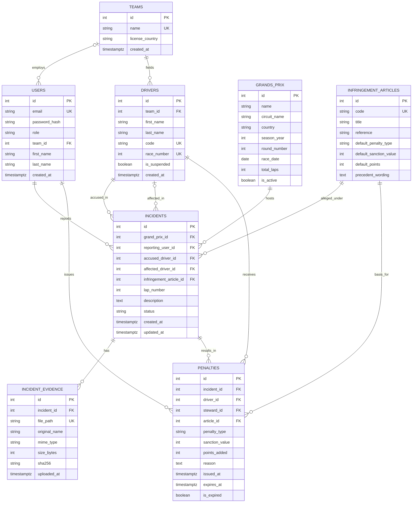

Akcje na kluczach obcych: `RESTRICT` wszędzie (zgłoszenia i orzeczenia to dokumenty), poza `incident_evidence.incident_id` → `CASCADE` (dowód nie istnieje bez sprawy).

---

## Szybki start (Czyste środowisko)

```bash
# 1. Sklonuj repozytorium
git clone https://github.com/Dysky2/wdpai-project.git
cd wdpai-project

# 2. Utwórz plik konfiguracji lokalnej
cp .env.example .env

# 3. Uruchom kontenery przez Docker Compose
docker compose up --build -d
```

Autoloader Composera (`vendor/`) generuje się automatycznie: obraz PHP wykonuje `composer install` przy buildzie, a entrypoint (`docker/php/docker-entrypoint.sh`) powtarza to przy starcie kontenera, gdy brakuje `vendor/autoload.php` lub zmienił się `composer.lock` (bind mount `.:/app` przykrywa katalog z obrazu). Ręczna instalacja nie jest potrzebna.

### Dostęp do usług:
- **Aplikacja webowa:** [http://localhost:8080](http://localhost:8080)
- **Skrzynka pocztowa (Mailpit):** [http://localhost:8025](http://localhost:8025)
- **PgAdmin:** [http://localhost:5050](http://localhost:5050) (login i hasło z `PGADMIN_DEFAULT_EMAIL` i `PGADMIN_DEFAULT_PASSWORD` w `.env`)

---

## Testy jednostkowe (PHPUnit)

```bash
docker compose exec php composer test
```

Testy (`tests/Unit/`, konfiguracja w `phpunit.xml`) nie wymagają bazy, sieci ani poczty: używają fałszywych zależności z `tests/Support/` (repozytoria w pamięci, `FixedClock`, `FakeTransactionRunner` z prawdziwym wycofaniem zmian w pamięci, `FakeMailer`, `FakeUploadedFileHandler`).

| Plik | Co sprawdza |
|---|---|
| `Service/IncidentServiceTest` | poprawny protest, oskarżony z własnego zespołu, numer okrążenia, maszyna stanów statusów, sprzątanie pliku po błędzie zapisu |
| `Service/PenaltyServiceTest` | naliczenie punktów, zawieszenie przy ≥ 12, rollback w połowie transakcji, błąd poczty nie cofa kary, wygasanie punktów po 365 dniach |
| `Service/UploadServiceTest` | poprawny PNG/JPG, skrypt PHP jako `.jpg`, zły MIME, plik > 5 MB, losowa nazwa |
| `Model/LicenceStatusTest` | progi 0 / 1–6 / 7–8 / 9–11 / ≥ 12 |
| `Http/RouterTest` | `{id}` dla `abc`, `0`, `-1` → 400, brak trasy → 404, wyjątek → 500 bez szczegółów |
| `Config/TranslationKeysTest` | identyczny zestaw kluczy w `pl.php` i `en.php` |

---

## Zadanie CRON: wygaszanie punktów karnych

`bin/cron.php expire-penalties` (w jednej transakcji) oznacza kary starsze niż 365 dni jako wygasłe, przelicza punkty dotkniętych kierowców i odwiesza tych, którzy spadli poniżej 12 punktów. Zadanie jest idempotentne, a wynik (liczba kar, suma punktów, odwieszeni kierowcy) trafia z czasem UTC do `storage/logs/cron.log`. Kod wyjścia: `0` OK, `1` błąd, `2` nieznane zadanie.

```bash
docker compose exec php php bin/cron.php expire-penalties
docker compose exec php cat storage/logs/cron.log
```

### Harmonogram (usługa `cron`)

Usługa `cron` w `docker-compose.yaml` (ten sam obraz co `php`) uruchamia `crond` w pierwszym planie i wykonuje zadanie codziennie o północy wg `docker/cron/crontab`. Kontener startuje dopiero, gdy baza jest zdrowa (healthcheck `pg_isready`). `crond` nie dziedziczy zmiennych środowiskowych, więc polecenie startowe zapisuje `DB_*`, `APP_*` i `SMTP_*` do `/etc/cron.env`, które crontab wczytuje przed uruchomieniem skryptu.

Jak sprawdzić działanie:

```bash
docker compose ps cron                       # usługa działa
docker compose logs cron                     # start crond
docker compose exec cron sh -c '. /etc/cron.env; php /app/bin/cron.php expire-penalties'   # ręczne wywołanie
```

Test harmonogramu bez czekania do północy: w `docker/cron/crontab` zamień `0 0 * * *` na `* * * * *`, wykonaj `docker compose restart cron`, po minucie sprawdź `storage/logs/cron.log` (nowy wpis `INFO expire-penalties`), a potem przywróć `0 0 * * *` i ponownie zrestartuj usługę.

---

## Bezpieczeństwo (Security Bingo)

Każdy punkt ma wskazanie pliku i linii oraz sposób weryfikacji. Kolumna „Test” opisuje sprawdzenie wykonane na działającej aplikacji (`curl`, `http://localhost:8080`).

| # | Zabezpieczenie | Dowód w kodzie | Test |
|---|---|---|---|
| 1 | Hasła: Argon2id + `password_verify` | `src/Service/AuthService.php:30` (`password_verify`), `:36-37` (`password_hash(..., PASSWORD_ARGON2ID)` przy rehashu); hashe w `db/seed.sql:66`, `:84` | logowanie kontem demo działa (302 → `/incidents`) |
| 2 | Jeden komunikat błędu logowania (brak enumeracji kont) | `src/Controller/AuthController.php:39` (jeden klucz `login.invalid_credentials`); `src/Service/AuthService.php:29` (fałszywy hash dla nieistniejącego e-maila, stały czas) | znany i nieznany e-mail dają to samo: 422 „Nieprawidłowy e-mail lub hasło” |
| 3 | SQL Injection: wyłącznie `prepare()` + `execute()` | `src/Core/Database.php:48-50` (`run()` to jedyne wejście do SQL, `prepare($sql)` z parametrami); w `src/` brak `->query(` i `->exec(` | `git grep -nE "->(query\|exec)\("  src` nie zwraca nic |
| 4 | Walidacja po stronie serwera | `src/Service/LoginValidator.php:22-31` (format e-maila `filter_var` oraz limity długości: e-mail ≤ 254, hasło ≤ 128 znaków, odrzucane przed Argon2; `maxlength` w `public/views/login.html.php`; test `tests/Unit/Service/LoginValidatorTest.php`), `src/Service/IncidentService.php:151-194` (`validateReport`: numer okrążenia, kierowcy, długość opisu); `src/Service/PenaltyService.php:148-175` (`validate`: artykuł, sankcja, punkty 0–3); `src/Service/Upload/UploadService.php:51-70` | `GET /incidents/abc` → 400 |
| 5 | XSS: escape na wyjściu | `src/View/ViewHelper.php:51` (`e()`: `htmlspecialchars(..., ENT_QUOTES, 'UTF-8')`); widoki w `public/views/` wypisują dane przez `$view->e()` lub bezpośrednio `htmlspecialchars(..., ENT_QUOTES, 'UTF-8')` (partiale `flash`, `form-field`); jedyne surowe wyjścia to `$content` (gotowy widok) i `src/View/ViewHelper.php:36-41` (JSON w `<script>` z `JSON_HEX_TAG\|JSON_HEX_AMP\|JSON_HEX_APOS\|JSON_HEX_QUOT`) | przegląd `grep -rnE '<\?=' public/views` – żadne dane użytkownika nie są wypisywane bez escapowania |
| 6 | Autoryzacja po stronie serwera: uwierzytelnienie | `src/Middleware/AuthMiddleware.php:19`; trasy w `config/routes.php` (`$auth`, `$principal`, `$steward`) | `GET /api/incidents` bez sesji → 401 JSON |
| 7 | Autoryzacja: role | `src/Middleware/RoleMiddleware.php:30-35` (`ForbiddenException`) | `TEAM_PRINCIPAL` na `GET /stewards/adjudicate/1` → 403; na `POST /api/incidents/1/investigate` z poprawnym tokenem CSRF → 403 JSON `forbidden` |
| 8 | Autoryzacja: własność zasobu | `src/Service/IncidentService.php:217-224` (`getForUser`: 404 gdy brak, 403 gdy sprawa obcego zespołu) | szef Mercedesa: `/incidents/1`, `/5`, `/12` → 403 (cudze sprawy), nieistniejące `/20`, `/27` → 404 |
| 9 | CSRF: token w sesji + `hash_equals`, każdy POST | `src/Http/Session.php:93` (`bin2hex(random_bytes(32))`), `src/Middleware/CsrfMiddleware.php:26` (tylko metody bezpieczne pomijane), `:31-32` (`hash_equals`, `CsrfTokenException` → 403 `csrf_invalid`); w każdej trasie POST w `config/routes.php:26-29` (kolejność: sesja 401 → CSRF 403 `csrf_invalid` → rola 403 `forbidden`; test `tests/Unit/Http/SecurityMiddlewareOrderTest.php`); formularze: `src/View/ViewHelper.php:65` (`csrfField`); Fetch: `public/views/layout.html.php:10` + `public/js/api.js:13-17` (`X-CSRF-Token`) | `POST /login` bez tokenu → 403 (strona „Nieprawidłowy lub brakujący token CSRF”); `POST /api/incidents/1/investigate` jako sędzia bez nagłówka lub ze złym tokenem → 403 JSON `{"error":{"code":"csrf_invalid",…}}`; bez sesji → 401 |
| 10 | Sesja: flagi ciasteczka | `src/Http/Session.php:124` (`HttpOnly`), `:125` (`SameSite=Lax`), `:123` (`Secure` gdy `APP_ENV=production`), `:31` (`use_strict_mode`) | `Set-Cookie: PHPSESSID=...; path=/; HttpOnly; SameSite=Lax` (lokalnie bez `Secure`, bo HTTP) |
| 11 | Sesja: regeneracja ID po logowaniu | `src/Http/Session.php:84` (`session_regenerate_id(true)`) | – |
| 12 | Strony chronione bez cache | `src/Middleware/AuthMiddleware.php:29` (`Cache-Control: no-store, private`) | `GET /incidents` (zalogowany) → nagłówek `Cache-Control: no-store, private` |
| 13 | Upload: prawdziwy MIME, limit, losowa nazwa | `src/Service/Upload/UploadService.php:13` (`MAX_BYTES` = 5 MB), `:55` (`finfo`), `:60` (`getimagesize`, obraz musi się zdekodować), `:17` (lista dozwolonych typów jpg/png), `:70` (`bin2hex(random_bytes(16))`); limit transportowy `docker/nginx/nginx.conf:8` | `tests/Unit/Service/UploadServiceTest.php` |
| 14 | Upload: brak wykonywania skryptów w `/uploads/` | `docker/nginx/nginx.conf:21-27` (każdy `*.php` w `/uploads/` → 404, reszta tylko do front controllera), `:30-35` (pliki wydaje wyłącznie lokalizacja `internal`: biała lista typów png/jpg, `default_type application/octet-stream`, `X-Content-Type-Options: nosniff`) | `GET /uploads/x.php` → 404 |
| 15 | Nginx: do PHP-FPM trafia tylko `/index.php` | `docker/nginx/nginx.conf:38-42` (`location = /index.php`), `:45-47` (każdy inny `*.php` → 404, w tym `*.html.php`) | `/views/login.html.php`, `/views/layout.html.php` → 404 |
| 16 | Brak wycieku informacji o błędach | `docker/php/Dockerfile` (`app.ini`: `display_errors = Off`, `log_errors = On`, `expose_php = Off`) | `php -i` w kontenerze pokazuje `display_errors => Off`; brak nagłówka `X-Powered-By` |
| 17 | Sekrety poza repozytorium | `.gitignore` (`.env`), `.env.example` tylko ze wzorcami, `docker-compose.yaml` (`${DB_PASSWORD:?set DB_PASSWORD in .env}`) | `git ls-files \| grep "^\.env$"` → pusto; `git grep` po `password\|secret\|api_key` w kodzie nie znajduje haseł |
| 18 | Brak otwartego przekierowania | `src/Controller/LanguageController.php:27-51` (`safeReturnPath`: tylko ścieżka i query z tego samego hosta) | – |
| 19 | Audyt nieudanych logowań (bez hasła, odporny na log injection) | `src/Service/LoginAuditLogger.php` (e-mail oczyszczony z znaków sterujących, przycięty do 100 znaków; IP z `REMOTE_ADDR`; wpis w `storage/logs/app.log`), wywołanie w `src/Controller/AuthController.php` | `tests/Unit/Service/LoginAuditLoggerTest.php`; błędne logowanie → wpis `Failed login: reason=invalid_credentials email="…" ip=…`, `grep` hasła w logu → 0 |
| 20 | Blokada brute-force: 5 nieudanych logowań na e-mail w 10 min → 429 do końca blokady (też dla nieistniejących kont, bez Argon2) | `src/Service/LoginThrottle.php` (okno, limit, reset po sukcesie), `src/Repository/PdoLoginAttemptRepository.php`, tabela `login_attempts` w `db/schema.sql`, użycie w `src/Controller/AuthController.php` | `tests/Unit/Service/LoginThrottleTest.php` (zegar `FixedClock`); 6 błędnych logowań `toto@mercedes.f1` → 422 ×5, potem 429, także z poprawnym hasłem |
| 21 | Nagłówki bezpieczeństwa na każdej odpowiedzi (strony, API, pliki statyczne, uploady, strony błędów 4xx/5xx): `Content-Security-Policy` (`default-src 'self'`, skrypt inline anty-FOUC dopuszczony tylko przez hash SHA-256, `frame-ancestors 'none'`, `object-src 'none'`, `base-uri`/`form-action 'self'`), `X-Frame-Options: DENY`, `X-Content-Type-Options: nosniff`, `Referrer-Policy: strict-origin-when-cross-origin`, `Permissions-Policy`, `Cross-Origin-Opener-Policy: same-origin` | `docker/nginx/security-headers.conf` (dołączany w `docker/nginx/nginx.conf:12`; żadna `location` nie ma własnego `add_header`, więc wszystkie, łącznie z `internal` dla dowodów, dziedziczą komplet z `server`); `always` = także odpowiedzi błędów | `curl -sI localhost:8080/views/layout.html.php` (404) i `curl -s -D - -o /dev/null localhost:8080/api/incidents` (401) pokazują komplet nagłówków; `/login` w trybie jasnym i ciemnym bez naruszeń CSP w konsoli |
| 22 | Dowody tylko dla uprawnionych: obraz widzi sędzia (wszystkie sprawy) i szef zespołu zgłaszającego lub oskarżonego, ta sama reguła co akta sprawy | `src/Controller/EvidenceController.php` (gość → 401, odpowiedź `X-Accel-Redirect` + `Cache-Control: private, no-store`), `src/Service/EvidenceService.php` (nazwa `^[a-f0-9]{32}\.(png\|jpg)$`, rekord w `incident_evidence`, potem `IncidentService::getForUser` → 404/403), `docker/nginx/nginx.conf:21-35` (brak statycznego `/uploads/`, pliki tylko z lokalizacji `internal`) | `tests/Unit/Service/EvidenceServiceTest.php`; `GET /uploads/<nazwa>.png`: anonim → 401, szef obcego zespołu → 403, szef zespołu zgłaszającego/oskarżonego i sędzia → 200 `image/png`; `/_protected/uploads/<nazwa>.png` → 404 |

Znane ograniczenie: flaga `Secure` działa dopiero po wdrożeniu pod HTTPS z `APP_ENV=production` (karta deployu).

## Deploy

> Link do wdrożenia zostanie dopisany po zrealizowaniu karty S8-31 (VPS + Docker Compose, HTTPS, `APP_ENV=production`). Do tego czasu aplikację uruchamia się lokalnie według sekcji „Szybki start”.

## Zasady developmentu

- Branch dla każdego zadania (konwencja `WDP-XX`).
- Małe, logiczne commity zgodne z konwencją (`feat:`, `fix:`, `docs:`, `test:`, `refactor:`, `chore:`).
- Sekrety wyłącznie w `.env` (plik `.env` bezwzględnie w `.gitignore`).
