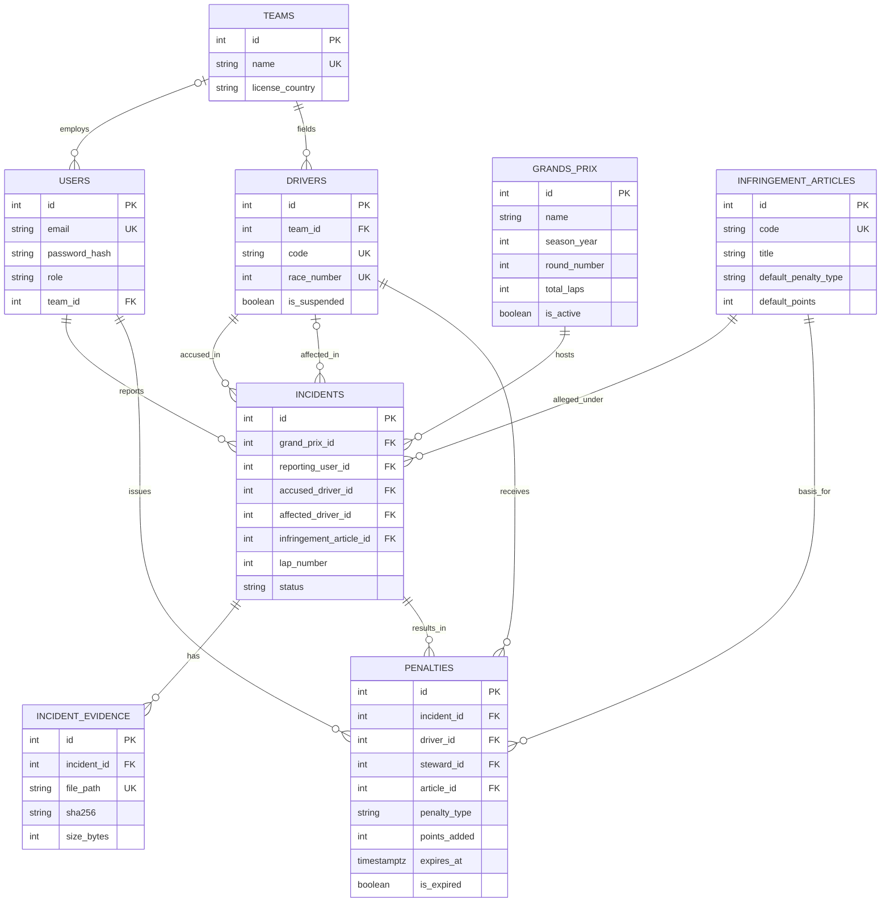

# Wytyczne: Baza danych (PostgreSQL 16)

**Agent:** `database` · **Model: Opus 5.5** (schemat, integralność i transakcje; błędy wychodzą dopiero przy demo lub utracie danych).
**Kryteria:** K10 (PostgreSQL), K11 (złożoność, 3NF), K12 (eksport `.sql`), K25 (widok / trigger / transakcja), K26 (akcje na referencjach), K6 (ERD w README).
**Czytaj najpierw:** `AGENTS.md` §§ 2, 7.2; karty Trello S1-06…S1-10; prototypy w `docs/ui` (pola formularzy i kolumny tabel to wymagania wobec schematu).

---

## 1. Zasady

- Połączenie tylko ze zmiennych środowiskowych (`DB_HOST`, `DB_PORT`, `DB_NAME`, `DB_USER`, `DB_PASSWORD`). PDO: `ERRMODE_EXCEPTION`, `FETCH_ASSOC`, `EMULATE_PREPARES=false`.
- Czas: `TIMESTAMPTZ` (UTC). Identyfikatory: `INT GENERATED ALWAYS AS IDENTITY` (zamiast `SERIAL`).
- Pliki w repozytorium: `db/schema.sql` (DDL, widok, trigger) i `db/seed.sql` (dane demo). Ładowane przez Docker alfabetycznie, tylko na pustym wolumenie. Placeholder `db/init.sql` usuń.
- Schemat i seed muszą przejść na pustej bazie bez błędów: `docker compose down -v && docker compose up -d db`, potem `docker compose logs db`.
- Po każdej zmianie schematu zaktualizuj: ERD w README (K6), `seed.sql`, model i repozytorium (zgłoś `backend`), kontrakty z `AGENTS.md` § 7.2 jeśli zmieniły się wartości enumów.

---

## 2. Schemat (8 tabel, 3NF)

Względem karty projektu (6 tabel) dodano `infringement_articles` (katalog artykułów i kar, jedno źródło dla list rozwijanych w protestach i orzeczeniach) oraz `incident_evidence` (metadane pliku: nazwa, rozmiar, SHA-256, jak w prototypie „Submitted Photo Evidence”; daje też uzasadnione `ON DELETE CASCADE`). Kolumna `users.team_name` z wczesnych notatek jest zastąpiona kluczem `team_id`.

```sql
CREATE TABLE teams (
    id              INT GENERATED ALWAYS AS IDENTITY PRIMARY KEY,
    name            VARCHAR(100) NOT NULL UNIQUE,
    license_country VARCHAR(3)   NOT NULL,
    created_at      TIMESTAMPTZ  NOT NULL DEFAULT now()
);

CREATE TABLE users (
    id            INT GENERATED ALWAYS AS IDENTITY PRIMARY KEY,
    email         VARCHAR(180) NOT NULL UNIQUE,
    password_hash VARCHAR(255) NOT NULL,
    role          VARCHAR(20)  NOT NULL CHECK (role IN ('TEAM_PRINCIPAL', 'FIA_STEWARD')),
    team_id       INT REFERENCES teams(id) ON DELETE RESTRICT,
    first_name    VARCHAR(100) NOT NULL,
    last_name     VARCHAR(100) NOT NULL,
    created_at    TIMESTAMPTZ  NOT NULL DEFAULT now(),
    CONSTRAINT ck_users_role_team CHECK (
        (role = 'TEAM_PRINCIPAL' AND team_id IS NOT NULL) OR
        (role = 'FIA_STEWARD'    AND team_id IS NULL))
);

CREATE TABLE drivers (
    id           INT GENERATED ALWAYS AS IDENTITY PRIMARY KEY,
    team_id      INT NOT NULL REFERENCES teams(id) ON DELETE RESTRICT,
    first_name   VARCHAR(100) NOT NULL,
    last_name    VARCHAR(100) NOT NULL,
    code         CHAR(3)      NOT NULL UNIQUE,          -- VER, HAM (widoczne w tabelach)
    race_number  INT          NOT NULL UNIQUE CHECK (race_number BETWEEN 1 AND 99),
    is_suspended BOOLEAN      NOT NULL DEFAULT FALSE,
    created_at   TIMESTAMPTZ  NOT NULL DEFAULT now()
);

CREATE TABLE grands_prix (
    id           INT GENERATED ALWAYS AS IDENTITY PRIMARY KEY,
    name         VARCHAR(150) NOT NULL,                 -- 2024 Monaco Grand Prix
    circuit_name VARCHAR(150) NOT NULL,
    country      VARCHAR(80)  NOT NULL,
    season_year  INT  NOT NULL CHECK (season_year >= 2024),
    round_number INT  NOT NULL CHECK (round_number BETWEEN 1 AND 30),
    race_date    DATE NOT NULL,
    total_laps   INT  NOT NULL CHECK (total_laps > 0),  -- walidacja numeru okrążenia
    is_active    BOOLEAN NOT NULL DEFAULT FALSE,        -- „Active session” w nagłówkach
    CONSTRAINT uq_season_round UNIQUE (season_year, round_number)
);
CREATE UNIQUE INDEX uq_single_active_gp ON grands_prix (is_active) WHERE is_active;

CREATE TABLE infringement_articles (                    -- katalog regulaminu i presety kar
    id                     INT GENERATED ALWAYS AS IDENTITY PRIMARY KEY,
    code                   VARCHAR(40)  NOT NULL UNIQUE, -- APP-L-IV-2
    title                  VARCHAR(150) NOT NULL,        -- Causing a Collision / Forcing Off Track
    reference              VARCHAR(200) NOT NULL,        -- FIA Sporting Code - Appendix L, Chapter IV, Art. 2
    default_penalty_type   VARCHAR(20)  NOT NULL,
    default_sanction_value INT,
    default_points         INT NOT NULL DEFAULT 0 CHECK (default_points BETWEEN 0 AND 3),
    precedent_wording      TEXT NOT NULL                 -- „Insert Precedent Wording”
);

CREATE TABLE incidents (
    id                     INT GENERATED ALWAYS AS IDENTITY PRIMARY KEY,
    grand_prix_id          INT NOT NULL REFERENCES grands_prix(id)           ON DELETE RESTRICT,
    reporting_user_id      INT NOT NULL REFERENCES users(id)                 ON DELETE RESTRICT,
    accused_driver_id      INT NOT NULL REFERENCES drivers(id)               ON DELETE RESTRICT,
    affected_driver_id     INT REFERENCES drivers(id)                        ON DELETE RESTRICT, -- kierowca zgłaszającego zespołu (opcjonalny; kolumna „vs” w prototypie)
    infringement_article_id INT NOT NULL REFERENCES infringement_articles(id) ON DELETE RESTRICT,
    lap_number             INT NOT NULL CHECK (lap_number > 0),
    description            TEXT NOT NULL CHECK (char_length(description) BETWEEN 20 AND 500),
    status                 VARCHAR(20) NOT NULL DEFAULT 'REPORTED'
        CHECK (status IN ('REPORTED', 'UNDER_INVESTIGATION', 'PENALTY_ISSUED', 'NO_FURTHER_ACTION')),
    created_at             TIMESTAMPTZ NOT NULL DEFAULT now(),
    updated_at             TIMESTAMPTZ NOT NULL DEFAULT now(),
    CONSTRAINT ck_incident_distinct_drivers CHECK (affected_driver_id IS DISTINCT FROM accused_driver_id)
);

CREATE TABLE incident_evidence (
    id            INT GENERATED ALWAYS AS IDENTITY PRIMARY KEY,
    incident_id   INT NOT NULL REFERENCES incidents(id) ON DELETE CASCADE,
    file_path     VARCHAR(255) NOT NULL UNIQUE,          -- względna, np. /uploads/a1b2….png
    original_name VARCHAR(255) NOT NULL,
    mime_type     VARCHAR(20)  NOT NULL CHECK (mime_type IN ('image/jpeg', 'image/png')),
    size_bytes    INT NOT NULL CHECK (size_bytes BETWEEN 1 AND 5242880),
    sha256        CHAR(64) NOT NULL,
    uploaded_at   TIMESTAMPTZ NOT NULL DEFAULT now()
);

CREATE TABLE penalties (
    id             INT GENERATED ALWAYS AS IDENTITY PRIMARY KEY,
    incident_id    INT NOT NULL REFERENCES incidents(id)              ON DELETE RESTRICT,
    driver_id      INT NOT NULL REFERENCES drivers(id)                ON DELETE RESTRICT,
    steward_id     INT NOT NULL REFERENCES users(id)                  ON DELETE RESTRICT,
    article_id     INT NOT NULL REFERENCES infringement_articles(id)  ON DELETE RESTRICT,
    penalty_type   VARCHAR(20) NOT NULL CHECK (penalty_type IN
        ('TIME_PENALTY', 'GRID_DROP', 'DRIVE_THROUGH', 'REPRIMAND', 'DISQUALIFICATION')),
    sanction_value INT,                                    -- sekundy lub miejsca
    points_added   INT NOT NULL DEFAULT 0 CHECK (points_added BETWEEN 0 AND 3),
    reason         TEXT NOT NULL,
    issued_at      TIMESTAMPTZ NOT NULL DEFAULT now(),
    expires_at     TIMESTAMPTZ NOT NULL,                   -- liczone w serwisie: issued_at + 365 dni
    is_expired     BOOLEAN NOT NULL DEFAULT FALSE,
    CONSTRAINT uq_penalty_incident_driver UNIQUE (incident_id, driver_id),
    CONSTRAINT ck_penalty_expiry CHECK (expires_at > issued_at),
    CONSTRAINT ck_penalty_value CHECK (
        (penalty_type IN ('TIME_PENALTY', 'GRID_DROP') AND sanction_value IS NOT NULL AND sanction_value > 0) OR
        (penalty_type NOT IN ('TIME_PENALTY', 'GRID_DROP') AND sanction_value IS NULL))
);
```

Uwagi projektowe:
- `expires_at` nie może być kolumną generowaną (`timestamptz + interval` nie jest `IMMUTABLE`). Liczy go jedna metoda serwisu (`PenaltyPolicy`), a CHECK pilnuje spójności.
- `affected_driver_id` wynika z prototypu: lista pokazuje `Car 1 (VER) vs Car 44 (HAM)`, ale także sprawy z jednym kierowcą (np. track limits), więc kolumna jest opcjonalna.
- Reguły międzytabelowe (kierowca nie może być z zespołu zgłaszającego, `affected_driver_id` musi być z zespołu zgłaszającego; `lap_number <= total_laps`; dozwolone przejścia statusów) egzekwuje `IncidentService` i testy. Trigger jest opcjonalny.
- Wartości `default_penalty_type` w katalogu muszą należeć do tego samego zbioru co `penalties.penalty_type` (dodaj analogiczny CHECK).
- Indeksy (poza PK/UNIQUE): `incidents(grand_prix_id)`, `incidents(status)`, `incidents(accused_driver_id)`, `incidents(reporting_user_id)`, `penalties(driver_id) WHERE NOT is_expired`, `penalties(expires_at) WHERE NOT is_expired` (CRON), `drivers(team_id)`.

---

## 3. Akcje na referencjach (K26)

| Klucz obcy | ON DELETE | Uzasadnienie na demo |
|---|---|---|
| `users.team_id`, `drivers.team_id` → `teams` | RESTRICT | nie usuwa się zespołu z kierowcami i kontami |
| `incidents.*` → `grands_prix`, `users`, `drivers` (oskarżony i poszkodowany), `infringement_articles` | RESTRICT | zgłoszenie jest dokumentem; nie ginie przez usunięcie słownika lub konta |
| `penalties.*` → `incidents`, `drivers`, `users`, `infringement_articles` | RESTRICT | orzeczenie to oficjalny dokument FIA; chroni historię kar |
| `incident_evidence.incident_id` → `incidents` | **CASCADE** | dowód nie istnieje bez sprawy; usunięcie sprawy testowej sprząta metadane (plik z dysku usuwa serwis) |

`ON UPDATE`: domyślne `NO ACTION`, bo klucze główne są niezmienne (IDENTITY). Zapytania łączące (JOIN) żyją w repozytoriach: lista incydentów = `incidents` + `grands_prix` + `drivers` + `teams` + `infringement_articles` + LEFT JOIN `penalties`; szczegóły sprawy dodatkowo `incident_evidence` i `users`.

---

## 4. Widok, trigger i transakcja (K25)

**Widok** `v_super_licence_standings`. Aktywna kara to `NOT is_expired AND expires_at > now()`, więc tabela jest poprawna także między przebiegami CRON:

```sql
CREATE OR REPLACE VIEW v_super_licence_standings AS
SELECT d.id AS driver_id, d.code, d.first_name, d.last_name, d.race_number,
       t.id AS team_id, t.name AS team_name, d.is_suspended,
       COALESCE(SUM(p.points_added) FILTER (WHERE NOT p.is_expired AND p.expires_at > now()), 0)::INT AS active_points,
       MIN(p.expires_at)            FILTER (WHERE NOT p.is_expired AND p.expires_at > now() AND p.points_added > 0) AS next_expiration
FROM drivers d
JOIN teams t ON t.id = d.team_id
LEFT JOIN penalties p ON p.driver_id = d.id
GROUP BY d.id, t.id;
```

Status (`SUSPENDED`, `AT_BAN_RISK`, `CAUTION`, `ACTIVE`, `CLEAN`) wylicza PHP z `active_points` (`LicenceStatus`, kontrakt w `AGENTS.md` § 7.2); nie duplikuj progów w SQL. Sortowanie i filtry (`>= 7`, `= 0`, wyszukiwanie) w zapytaniu repozytorium.

**Trigger** `set_updated_at()` na `incidents`: prosty, realny i pokazywalny na demo.

```sql
CREATE OR REPLACE FUNCTION set_updated_at() RETURNS trigger AS $$
BEGIN
    NEW.updated_at := now();
    RETURN NEW;
END;
$$ LANGUAGE plpgsql;

CREATE TRIGGER trg_incidents_updated_at
BEFORE UPDATE ON incidents
FOR EACH ROW EXECUTE FUNCTION set_updated_at();
```

**Transakcja nałożenia kary** (implementuje `backend`, schemat ma ją umożliwiać): `BEGIN` → `SELECT … FROM drivers WHERE id = ? FOR UPDATE` (blokada przeciw wyścigowi dwóch orzeczeń) → `INSERT penalties` → `UPDATE incidents SET status = 'PENALTY_ISSUED'` → przeliczenie aktywnych punktów → `UPDATE drivers SET is_suspended` przy ≥ 12 → `COMMIT`; przy błędzie `ROLLBACK`.

---

## 5. Seed (`db/seed.sql`) — K12 i scenariusz demo

Dane muszą działać niezależnie od daty uruchomienia: daty kar względem `now()`, np. `now() - interval '347 days'`.

- 10 zespołów i 20 kierowców sezonu 2024 (kody i numery jak na prototypach: VER 1, PER 11, HAM 44, RUS 63, LEC 16, SAI 55, NOR 4, PIA 81, ALO 14, STR 18, GAS 10, OCO 31, ALB 23, SAR 2, TSU 22, RIC 3, BOT 77, ZHO 24, MAG 20, HUL 27).
- GP: Bahrain, Saudi Arabia i **2024 Monaco Grand Prix** (runda 8, 78 okrążeń, `is_active = true`).
- Katalog `infringement_articles`: min. 6 pozycji (Causing a Collision / Forcing Off Track, Track Limits, Pit Lane Infringement, Unsafe Release, Impeding, Leaving the Track and Gaining Advantage) z presetem kary i tekstem precedensu (np. Appendix L Ch. IV Art. 2 → +5 s, 2 pkt).
- Konta: `toto@mercedes.f1` (TEAM_PRINCIPAL, Mercedes), `steward@fia.org` (FIA_STEWARD); hash `password_hash('demo123', PASSWORD_ARGON2ID)` wygenerowany w kontenerze `php` i wklejony jako stała. Jawne hasło demo tylko w README.
- 12 spraw odtwarzających liczniki z prototypu: 3 REPORTED, 2 UNDER_INVESTIGATION, 3 PENALTY_ISSUED, 4 NO_FURTHER_ACTION; w tym Verstappen vs Hamilton, okrążenie 24, Monaco (sprawa z ekranu „Dossier”).
- Punkty tak, by tabela Superlicencji odpowiadała prototypowi: Magnussen 10 (najstarsza kara wygasa za ok. 18 dni), Pérez 7, Stroll 5, Verstappen 4, Tsunoda 3, Russell 2, reszta 0.
- Co najmniej jedna kara **po terminie** (`expires_at` wczoraj, `is_expired = false`), żeby `php bin/cron.php expire-penalties` miało co przedawnić podczas demo, oraz jeden kierowca z `is_suspended = true` do pokazania odwieszenia.

---

## 6. ERD (K6) — blok Mermaid w README musi odpowiadać schematowi



Po każdej zmianie schematu porównaj diagram z `db/schema.sql` kolumna po kolumnie.

---

## 7. Definicja ukończenia i czego nie robić

Gotowe, gdy: schemat i seed ładują się na pustej bazie, widok zwraca wartości z prototypu, CHECK-i odrzucają dane niepoprawne (przetestuj ręcznie kilka `INSERT`-ów), ERD w README zgadza się z `schema.sql`, a uzasadnienie każdego `ON DELETE` potrafisz powiedzieć jednym zdaniem.
Nie rób: nie dopisuj logiki do widoku, której miejscem jest PHP (progi statusów); nie zmieniaj kodu aplikacji ani Dockera; nie wklejaj do seeda prawdziwych danych osobowych ani haseł jawnym tekstem.
